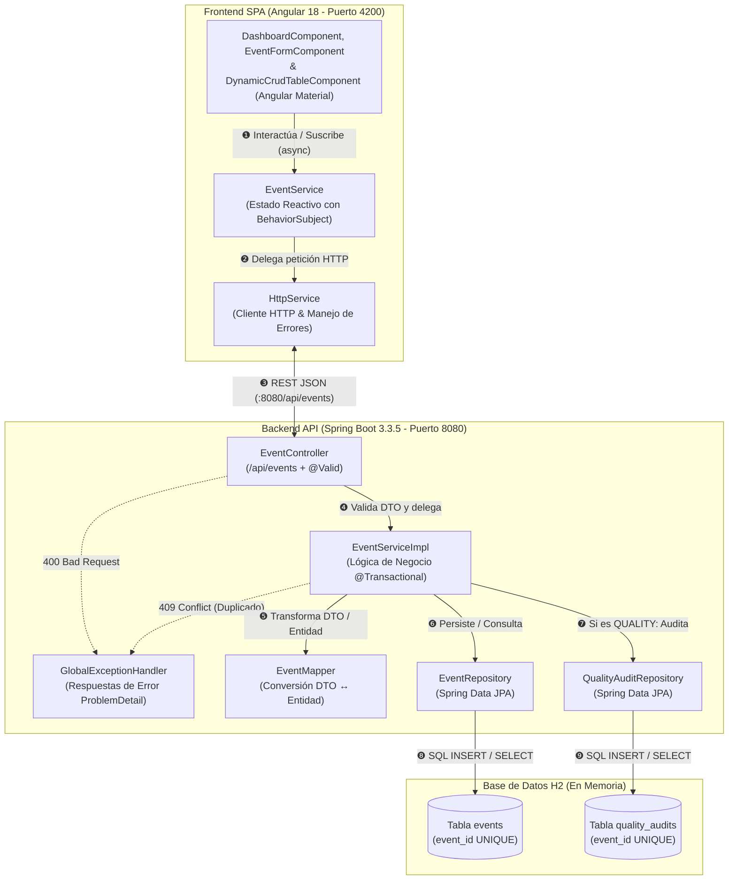
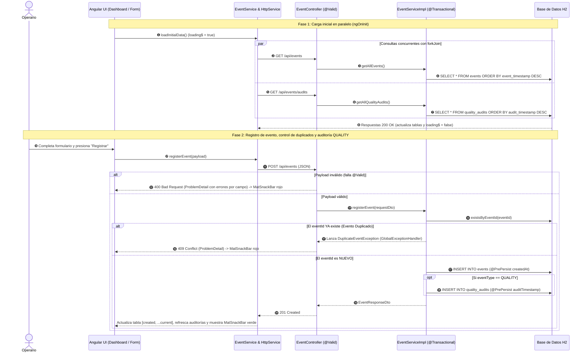
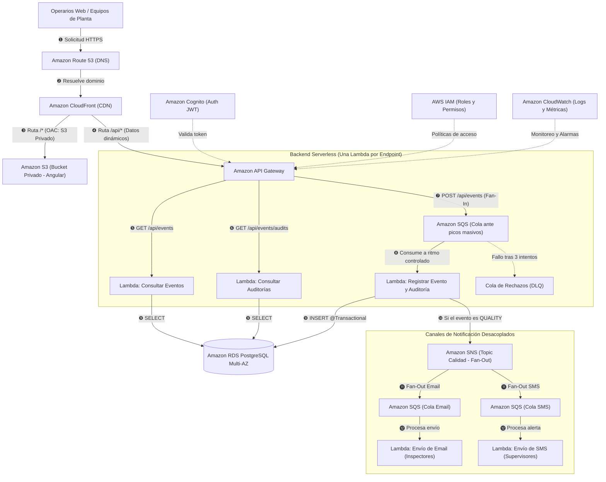

# Factory Events Platform

Sistema web para el registro, control de duplicados y consulta de eventos de planta en tiempo real.  
Desarrollado con **Java 17 + Spring Boot 3**, base de datos en memoria **H2** y **Angular 18 + Angular Material**.

---

## 1. Reglas de Negocio

El sistema gestiona los eventos enviados por los equipos de una planta industrial. Cada evento contiene:
- **`eventId`:** Identificador único del evento en el sistema de origen (formato `EVT-####`, por ejemplo `EVT-1001`).
- **`eventType`:** Tipo de evento (`PRODUCTION` o `QUALITY`).
- **`description`:** Detalle del suceso registrado.
- **`timestamp`:** Fecha y hora del evento.

### Reglas aplicadas:
1. **Eventos de Producción (`PRODUCTION`):** Se registran únicamente en la tabla principal de eventos.
2. **Eventos de Calidad (`QUALITY`):** Se registran en la tabla de eventos y **generan automáticamente un registro en la tabla de auditorías de calidad**.
3. **Control de duplicados:** Se valida la unicidad por `eventId`. Si se intenta procesar un identificador ya existente (desde la interfaz web o invocando directamente a la API), el sistema responde con código HTTP **`409 Conflict`** e impide generar un segundo registro del evento o una segunda auditoría.

### Tecnologías utilizadas:
- **Backend:** Java 17 LTS, Spring Boot 3.3.5 (Spring Data JPA, Bean Validation, Actuator).
- **Base de Datos:** H2 Database en memoria (`jdbc:h2:mem:factory_db`), con consola web en `/h2-console`.
- **Frontend:** Angular 18 (componentes standalone, formularios reactivos y Angular Material).
- **Contenedores:** Docker y Docker Compose.

---

## 2. Arquitectura y Principales Decisiones Técnicas

### Breve Descripción de la Arquitectura
La solución sigue una arquitectura **Cliente-Servidor desacoplada** comunicada por HTTP/JSON:
- **Backend (`Spring Boot 3.3.5`):** Organizado en capas con responsabilidades separadas: `controller` (exposición REST en `/api/events`), `service` (reglas de negocio y transacciones), `mapper` (conversión entre DTOs y entidades), `repository` (acceso a datos con Spring Data JPA sobre H2) y `exception` (manejo global de errores).
- **Frontend (`Angular 18`):** Aplicación SPA estructurada en tres módulos (`core`, `shared` y `features/events`), utilizando componentes *Standalone* para las vistas y servicios reactivos con RxJS para sincronizar el estado entre el formulario y las tablas.

### Principales Decisiones Técnicas
- **Manejo estructurado de excepciones con `ProblemDetail`:** Se utiliza `@RestControllerAdvice` junto con la clase nativa `ProblemDetail` de Spring Boot 3 (basada en el estándar RFC 7807) para devolver errores HTTP uniformes (`409 Conflict`, `400 Bad Request`, `500 Internal Server Error`) con `title`, `status`, `detail` y propiedades adicionales sin crear clases de error manuales.
- **Uso de Java 17 `record` y Bean Validation en DTOs:** Los objetos de entrada y salida se definen como `record` inmutables, aplicando anotaciones (`@NotBlank`, `@Pattern`, `@NotNull`, `@Size`) para rechazar datos inválidos antes de llegar a la capa de servicio.
- **Desacoplamiento entre Eventos y Auditorías:** En lugar de unir ambas tablas con una clave foránea rígida `@OneToOne`, se vinculan mediante el identificador de negocio `eventId`. Esto permite consultar e insertar en cada tabla de forma independiente sin sobrecarga de `JOIN`.
- **Atomicidad con `@Transactional`:** El alta de un evento `QUALITY` y la creación de su auditoría se ejecutan dentro de una misma transacción; si ocurre un fallo en cualquiera de los dos pasos, se revierte toda la operación. En las consultas se utiliza `@Transactional(readOnly = true)` para que Hibernate no consuma memoria rastreando cambios.
- **Control de duplicados en dos niveles:** Se verifica primero en el servicio mediante `existsByEventId` para responder con un mensaje claro (`409 Conflict`), respaldado por una restricción `@Column(unique = true)` en la base de datos para bloquear colisiones ante peticiones simultáneas.
- **Manejo de fecha y hora (`timestamp`, `createdAt` y `auditTimestamp`):** El formulario web autocompleta por defecto la fecha y hora local actual (con segundos) para agilizar la carga, permitiendo también elegir manualmente otra fecha en el calendario o actualizarla con el botón *"Usar hora actual"*. Por su parte, el backend valida el `timestamp` recibido del evento y asigna automáticamente con `@PrePersist` la hora exacta en que se guardó el registro (`createdAt` en eventos y `auditTimestamp` en auditorías).
- **Persistencia en memoria con H2:** Permite ejecutar la aplicación y las pruebas de forma inmediata sin requerir bases de datos externas instaladas, manteniendo compatibilidad directa con motores relacionales como PostgreSQL a través de JPA.
- **Frontend Reactivo con Angular 18 y Angular Material:**
  - *Componentes Standalone:* Cada componente importa directamente lo que utiliza, simplificando la estructura del proyecto y facilitando componentes reutilizables como la tabla dinámica (`DynamicCrudTableComponent`).
  - *Sincronización con `BehaviorSubject` y `forkJoin`:* La carga inicial dispara en paralelo las consultas de eventos y auditorías mediante `forkJoin`, controlando la barra de carga (`loading$`) con `finalize`. Al registrar un evento nuevo, la tabla se actualiza en memoria (`[created, ...current]`) sin recargar la pantalla.
  - *Angular Material:* Se emplean los componentes oficiales (`MatTable`, `MatTabs`, `MatSnackBar`, `MatChip`) para resolver la grilla, las pestañas y las alertas superiores de éxito (verde) y error (rojo).
- **Validación en dos capas (Frontend y Backend):** El formulario reactivo valida en tiempo real el formato `EVT-####` y la longitud de la descripción para dar respuesta inmediata al usuario, mientras que el backend vuelve a validar todos los campos para proteger la API ante envíos directos por `cURL` o `Postman`.
- **Logs y Observabilidad:** Registro en consola con SLF4J (`INFO` al procesar eventos y `WARN` al detectar duplicados o datos inválidos) y endpoint de salud `/actuator/health` expuesto con Spring Boot Actuator para monitoreo de Docker.

### Diagrama de Arquitectura del Sistema (Fullstack)


### Diagrama de Secuencia: Flujo Completo de Carga, Validación, Duplicados y Auditoría


---

## 3. Cómo Ejecutar el Proyecto (Backend y Frontend)

### Requisitos previos:
- **Con Docker (Opción A - Recomendada):**
  - **En Windows o macOS:** Tener instalado y en ejecución **Docker Desktop**.
  - **En Linux:** Tener instalado **Docker Engine** y **Docker Compose** (`docker compose version`).
- **En local sin Docker (Opción B):**
  - Java JDK 17 o superior (`java -version`).
  - Apache Maven 3.8 o superior (`mvn -version`).
  - Node.js 18 o 20 LTS y npm (`node -v`, `npm -v`).

---

### Opción A: Con Docker Compose (Recomendado)

En la raíz del proyecto, ejecutar:

```bash
docker compose up --build
```

Servicios disponibles:
- **Frontend:** [http://localhost:4200](http://localhost:4200)
- **API Backend:** [http://localhost:8080/api/events](http://localhost:8080/api/events)
- **Consola H2:** [http://localhost:8080/h2-console](http://localhost:8080/h2-console)  
  *(JDBC URL: `jdbc:h2:mem:factory_db` | Usuario: `sa` | Contraseña vacía)*
- **Health Check:** [http://localhost:8080/actuator/health](http://localhost:8080/actuator/health)

Para detener los servicios:
```bash
docker compose down
```

---

### Opción B: Ejecución en Local

#### 1. Iniciar Backend
```bash
cd backend
mvn clean spring-boot:run
```
Disponible en `http://localhost:8080`.

#### 2. Iniciar Frontend
En otra terminal:
```bash
cd frontend
npm install
npm start
```
Disponible en `http://localhost:4200`.

---

## 4. Cómo Ejecutar las Pruebas Automatizadas

El backend cuenta con **8 pruebas automatizadas** que validan la lógica de negocio y las respuestas HTTP del controlador:

1. **Pruebas Unitarias de Servicio (`EventServiceTest` - JUnit 5 y Mockito):**
   - Verifica que un evento `PRODUCTION` se guarda y **no** genera auditoría.
   - Verifica que un evento `QUALITY` se guarda y **genera automáticamente** su auditoría de calidad.
   - Verifica que un `eventId` repetido lanza `DuplicateEventException` sin guardar ni auditar por segunda vez.
2. **Pruebas de Controlador REST (`EventControllerTest` - `@WebMvcTest` y `MockMvc`):**
   - `POST /api/events` válido retorna `201 Created`.
   - `POST /api/events` duplicado retorna `409 Conflict`.
   - `POST /api/events` con campos inválidos retorna `400 Bad Request`.
   - `GET /api/events` retorna `200 OK` con la lista de eventos.
   - `GET /api/events/audits` retorna `200 OK` con la lista de auditorías.

### Comando para ejecutar las pruebas:
```bash
cd backend
mvn clean test
```

---

## 5. Cómo Reproducir un Evento Duplicado y Verificar la Auditoría de QUALITY

### Caso 1: Reproducir un evento duplicado desde la Interfaz Web (`409 Conflict`)
1. Abrir [http://localhost:4200](http://localhost:4200).
2. Completar el formulario con el identificador `EVT-1001`, tipo **`PRODUCTION`** y una descripción.
3. Hacer clic en **"Registrar"**: se mostrará una notificación verde (`201 Created`) y el evento aparecerá en la tabla **Eventos**.
4. Volver a hacer clic en **"Registrar"** manteniendo el mismo `EVT-1001`: el sistema rechazará el envío mostrando una notificación roja (`"El evento 'EVT-1001' ya fue registrado y no se admiten duplicados."` - HTTP `409 Conflict`) sin duplicar filas en la tabla.

### Caso 2: Verificar la generación de auditoría en eventos `QUALITY`
1. Ingresar un identificador nuevo (por ejemplo, `EVT-2002`).
2. Seleccionar tipo **`QUALITY (Genera Auditoría)`**, escribir una descripción y hacer clic en **"Registrar"**.
3. Abrir la pestaña **"Auditorías de Calidad"**: se verá el registro generado automáticamente con el `eventId` `EVT-2002`, su descripción y la fecha/hora de auditoría (`auditTimestamp`).
4. Si se intenta volver a enviar `EVT-2002`, el sistema responderá `409 Conflict` y no creará una segunda auditoría.

### Caso 3: Reproducir un evento duplicado directamente contra la API (cURL / Sin Interfaz Web)
Para verificar que el control de duplicados actúa en el backend sin pasar por la interfaz web, ejecutar el mismo comando dos veces en una terminal:

```bash
curl -i -X POST http://localhost:8080/api/events \
  -H "Content-Type: application/json" \
  -d '{
    "eventId": "EVT-1001",
    "eventType": "PRODUCTION",
    "description": "Production line started",
    "timestamp": "2026-05-20T10:00:00"
  }'
```
* **1° envío:** Retorna `HTTP/1.1 201 Created` con el evento guardado.
* **2° envío (mismo `eventId`):** Retorna `HTTP/1.1 409 Conflict`:
  ```json
  {
    "type": "about:blank",
    "title": "Evento Duplicado",
    "status": 409,
    "detail": "El evento 'EVT-1001' ya fue registrado y no se admiten duplicados.",
    "instance": "/api/events",
    "eventId": "EVT-1001"
  }
  ```

---

## 6. Posibles Mejoras Futuras

### A. En la Aplicación (Java y Angular)
* **Paginación en grilla (`Pageable` + `MatPaginator`):** Conectar `Pageable` de Spring Data JPA con el paginador de Angular Material para consultar los eventos por páginas cuando el histórico crezca.
* **Validación Asíncrona en el Formulario (`AsyncValidator` con `debounceTime`):** Agregar un validador asíncrono en el campo `eventId` que consulte a la API mientras el usuario escribe (esperando 300ms) para avisarle si el código ya existe antes de enviar el formulario.
* **Búsqueda y Filtros en Tabla:** Sumar un buscador para filtrar eventos en tiempo real por `eventId`, tipo de evento o texto de la descripción.
* **Servicio Base Genérico y Fachada HTTP (`GenericHttpService<T>`):** Si el sistema suma nuevas pantallas y entidades (máquinas, turnos, operarios), se puede centralizar una fachada HTTP genérica en 4 capas (`Componente ➔ Servicio de Entidad ➔ Fachada HTTP ➔ HttpClient`) para reutilizar el armado de parámetros, headers y alertas sin repetir código:

  ```mermaid
  flowchart TD
      subgraph C1 ["1. Capa UI (Presentación)"]
          Comp["DashboardComponent<br/>(Vista, Tabla y Formularios)"]
      end

      subgraph C2 ["2. Capa Dominio (Servicio de Entidad)"]
          EvtServ["EventService<br/>(Lógica de Eventos y Auditorías)"]
      end

      subgraph C3 ["3. Capa Core (Fachada HTTP)"]
          Facade["HttpService / Fachada<br/>(Parámetros, Headers y Notificaciones)"]
      end

      subgraph C4 ["4. Capa Infraestructura (Angular & RxJS)"]
          HttpCli["HttpClient (@angular/common/http)"]
          Rx["RxJS Observables (Flujo Reactivo)"]
      end

      Comp -->|"❶ Solicita datos"| EvtServ
      EvtServ -->|"❷ Delega llamada"| Facade
      Facade -->|"❸ Ejecuta petición"| HttpCli

      HttpCli -.->|"❹ Respuesta HTTP"| Rx
      Rx -.->|"❺ Retorna Observable"| Facade
      Facade -.->|"❻ Procesa error o éxito"| EvtServ
      EvtServ -.->|"❼ Actualiza vista"| Comp
  ```
* **Evolución de la Arquitectura Backend:** Actualmente el proyecto es un **monolito simple en capas** (`Controlador ➔ Servicio ➔ Repositorio JPA`), acorde al alcance actual. Si el sistema crece en módulos y tráfico, su evolución natural sería:
  - *De Monolito Simple a Monolito Modular y luego Microservicios:* Primero separar el código en módulos de negocio independientes dentro del mismo `.jar` (`eventos` y `auditorias`), y recién cuando la carga exija escalar por separado, llevar cada módulo a su propio **Microservicio** (facilitado porque ambas tablas ya se comunican solo por el `eventId`).
  - *Arquitectura Hexagonal (Puertos y Adaptadores):* Aislar las reglas de negocio en clases Java puras comunicadas por interfaces (Puertos), permitiendo cambiar la base de datos (por ejemplo, pasar a MongoDB o DynamoDB) o sumar nuevas entradas (como colas de mensajería) creando solo el adaptador correspondiente sin tocar la lógica central.
* **Seguridad y Roles (Spring Security + JWT):** Autenticación de usuarios para que los operarios registren eventos de línea y solo los supervisores accedan a las auditorías de calidad.
* **Exportación de Reportes (Apache POI / OpenPDF):** Descarga de eventos en Excel (`.xlsx`) y reportes de auditoría en PDF.
* **Gráficos de Resumen (Chart.js):** Indicadores visuales con la cantidad de eventos `PRODUCTION` y `QUALITY` por jornada.

### B. Evolución hacia Producción en la Nube (AWS)
Para llevar la plataforma a producción en AWS, se plantea una arquitectura Serverless con **una función Lambda por cada endpoint** y colas de mensajería para absorber picos de carga en planta:

#### Diagrama de Arquitectura Cloud



#### Detalle de Componentes y Flujo de Datos

* **Frontend Estático y Cero Problemas de CORS (S3 + CloudFront + OAC):**
  - El build de Angular se aloja en un bucket **Amazon S3** privado protegido con OAC (*Origin Access Control*) para que solo pueda accederse desde **CloudFront**.
  - CloudFront unifica todo bajo un mismo dominio: la ruta `/*` entrega el frontend desde S3 y la ruta `/api/*` redirige al backend en API Gateway, evitando problemas de CORS en el navegador.

* **Backend Serverless Granular (Una Lambda por Endpoint):**
  - **1. Lambdas de Consulta (`GET /api/events` y `GET /api/events/audits`):** Leen directamente de PostgreSQL sin pasar por colas para responder en tiempo real a la pantalla, contando únicamente con permisos de lectura (`SELECT`).
  - **2. Mitigación del Arranque en Frío (*Cold Start*):** En arquitecturas Serverless, cuando una función en Java pasa tiempo inactiva se apaga, y la primera petición demora unos segundos extra mientras levanta la máquina virtual de Java (JVM) y el contexto de Spring. Para evitar esa demora en las consultas de usuario, se activa **AWS Lambda SnapStart**, que guarda una instantánea (*snapshot*) de la Lambda ya inicializada para que arranque en milisegundos.
  - **3. Lambda de Registro (`POST /api/events`) + Cola SQS y DLQ:**
    - Las peticiones de alta entran primero en una cola **Amazon SQS** (*Fan-In*), que amortigua los picos de eventos enviados por las máquinas para no saturar las conexiones de la base de datos.
    - La Lambda lee los mensajes de la cola y verifica si el `eventId` ya existe: si es nuevo, guarda el evento y la auditoría en una misma transacción; si está repetido, deja un aviso `WARN` en el log y retira el mensaje de la cola sin reinsertarlo.
    - Si ocurre un fallo técnico real (por ejemplo, corte de conexión con la base), tras 3 reintentos fallidos SQS envía el mensaje a una **Cola de Rechazos (DLQ)** para no perder el evento y reprocesarlo luego.

* **Alertas de Calidad Desacopladas (Fan-Out con SNS + SQS):**
  - Cuando se registra un evento `QUALITY`, la Lambda publica un aviso en **Amazon SNS**, que lo reparte en simultáneo (*Fan-Out*) hacia dos colas independientes: **SQS Email** (para inspectores) y **SQS SMS** (para supervisores). Así, si el proveedor de SMS demora o falla, el envío de correos sigue funcionando sin bloquearse.

* **Base de Datos, Seguridad e Infraestructura como Código:**
  - **Amazon RDS PostgreSQL Multi-AZ:** Reemplaza a H2 en producción manteniendo una réplica sincrónica de respaldo en otro centro de datos ante caídas, sin cambiar el código de Spring Data JPA.
  - **Seguridad y Monitoreo:** Credenciales resguardadas en **AWS Secrets Manager**, datos encriptados con **AWS KMS**, autenticación JWT en **Amazon Cognito** y logs centralizados con alarmas en **Amazon CloudWatch**.
  - **AWS CDK:** Toda la infraestructura se define como código para desplegar entornos completos de forma automatizada.

---

## Autor

- **Juan José Vargas** — [Perfil en LinkedIn](https://www.linkedin.com/in/juan-vargas-dev/)
